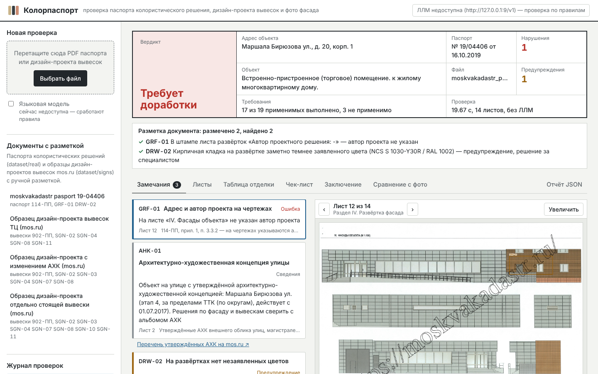
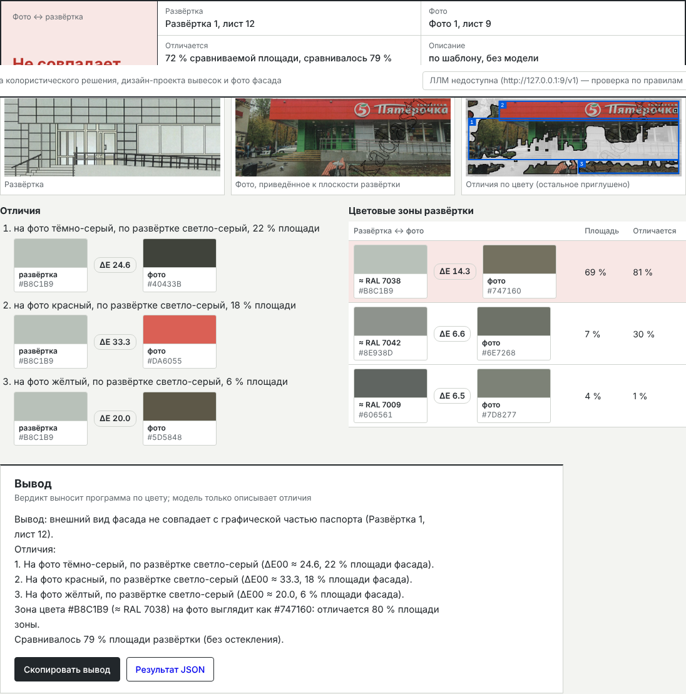

# Колорпаспорт — проверка документов и внешнего вида фасада

MVP для хакатона «Архитектура цифрового города», **кейс 7** (карточка — `docs/case-card.md`): проверка комплекта
документов по НПА с наглядным отчётом и сравнение фото здания (снимок инспектора, скрин с городской камеры)
с графической частью документов — «совпадает / не совпадает».



## Что умеет

**Два вида документов** — сервис сам определяет, что загружено:

- **Паспорт колористического решения** (ПП Москвы № 114-ПП) — 22 проверки: комплектность разделов I–V и всех
  фасадов; общие сведения и единый адрес; штампы, масштаб, серое остекление, нет высотных отметок; марки NCS
  и RAL, их корректность и согласованность, образцы цвета; **пояснительная записка по существу** — характеристика
  объекта и существующее состояние по всем элементам формы (кровля, стены, ограждения, окна, двери, цоколь,
  лестницы, детали, иные поверхности), записка ↔ таблица отделки; цвета зон на развёртках ↔ таблица,
  незаявленные цвета, выноски.
- **Дизайн-проект размещения вывесок** (ПП Москвы № 902-ПП) — 11 проверок: состав (записка, фотофиксация,
  чертежи, фотомонтаж, экспликация); записка заполнена, а не оставлен текст образца; масштаб чертежей;
  размеры каждой вывески из экспликации против Правил (настенные до 0,5 м / 0,75 м без подложки и до 15 м,
  консольные до 1 × 0,2 м с выносом до 1 м, на витрине до 0,4 м); запрещённые решения (неон, мигание, бегущая
  строка, ткань, оклейка витрин…); адрес и заказчик; дата фотофиксации не старше двух месяцев; сквозная
  нумерация; разрешение фото.
- **Архитектурно-художественные концепции**: по адресу определяется, утверждена ли АХК для улицы (≈ 290 улиц
  и территорий, 4 этапа, `data/ahk_streets.csv`), со ссылкой на перечень Москомархитектуры.

**Сравнение фото с графической частью** (вкладка «Сравнение с фото»): развёртка, чертёж или фотомонтаж из документа
против своего фото или фото из фотофиксации. Углы фасада на фото можно найти автоматически (по линиям фасада)
и поправить мышью. Программа выравнивает фото, сравнивает цвет каждой зоны по ΔE00 с поправкой на экспозицию,
строит карту отличий и выносит вердикт. Мультимодальная модель (сервис `chat`) описывает отличия словами
(вывески, кондиционеры, проёмы); вердикт считает код — модель может только поднять «совпадает» до «требует внимания».



**Языковые модели — только в сервисе `chat`**: основная — модель в LM Studio на ноутбуке разработчика (прод
обращается к ней через ngrok), запасная — **GigaChat API** (облако Сбера). Бэкенд к моделям не обращается: проверка
документа, разбор пояснительной записки и сравнение фото — правила и код. Сервис `chat` отвечает на вопросы
по отчёту, по кнопке формулирует заключение и описывает отличия на фото, а результат сохраняет в бэкенд через его
API. Модель — помощник, а не судья: решения «соответствует / нет» принимает код по `rules.yaml`. Нет ни одной
модели — всё, кроме чата и текстов модели, работает.

**Отчёт**: штамп-вердикт, каждое замечание выделено на листе, колеры «заявлено / фактически» с ΔE, таблица отделки
или экспликация вывесок, чек-лист со ссылками на НПА, заключение (копировать / скачать .md). История проверок
и сравнений — в **PostgreSQL**, файлы отчётов — в `./runs`.

## Запуск

Нужен только Docker Desktop (Python, Node, tesseract, PostgreSQL — внутри образов). Два compose-файла:

| Файл | Для чего | Что запускает |
|---|---|---|
| `compose.yml` | локальная разработка | Django `runserver` и Vite с автоперезагрузкой (код смонтирован), PostgreSQL |
| `compose.prod.yml` | сервер | сборка образов: gunicorn, Caddy (собранный фронтенд, HTTPS, прокси `/api`), PostgreSQL |

### Локально

```bash
cp .env.example .env                          # один раз; в .env — адрес LM Studio и ключ GigaChat API
docker compose up --build                     # интерфейс → http://localhost:5173, API → http://localhost:8000/api/health
docker compose down                           # остановить (данные базы остаются в томе pgdata)
```

| Сервис | Что внутри | Порт |
|---|---|---|
| `frontend` | Vite dev server, `/api` проксируется на backend, `/chat` — на chat | 5173 (`COLORPASS_PORT`) |
| `chat` | языковые модели: Node + TanStack AI; чат, заключение, описание фото; LM Studio, запасной GigaChat | 127.0.0.1:3000 |
| `backend` | Django `runserver` + ядро проверки, tesseract, сертификаты НУЦ Минцифры | 127.0.0.1:8000 |
| `db` | PostgreSQL 16: проверки, замечания, сравнения фото | 127.0.0.1:5432 (`COLORPASS_DB_PORT`) |

### Прод: https://ai-pipetka.fun

Деплой автоматический: пуш в `main` → GitHub Actions (`.github/workflows/deploy.yml`) копирует код на сервер (`/opt/colorpass`), пишет там `.env` из секретов репозитория и выполняет
`docker compose -f compose.prod.yml up -d --build`. Caddy сам получает и продлевает сертификат Let's Encrypt.

Секреты репозитория (Settings → Secrets and variables → Actions): `SSH_HOST`, `SSH_USER`, `SSH_PRIVATE_KEY`
(публичная часть ключа — в `~/.ssh/authorized_keys` на сервере), `GIGACHAT_AUTH_KEY`, `POSTGRES_PASSWORD`,
`DJANGO_SECRET_KEY`, для локальной модели — `LOCAL_LLM_URL`, `LOCAL_LLM_KEY` (секреты) и `LOCAL_LLM_MODEL`
(переменная). Для HTTPS нужны A-запись `ai-pipetka.fun` → IP сервера и открытые порты 80 и 443.
Docker на сервере ставится при первом деплое, если его нет.

На сервере вручную: `cd /opt/colorpass && docker compose -f compose.prod.yml logs -f` (логи),
`docker compose -f compose.prod.yml ps` (состояние).

### Языковые модели (сервис `chat`)

Всё, что связано с моделями, — в сервисе `chat/` (Node 22, Hono, [TanStack AI](https://tanstack.com/ai)). Бэкенд
работает только по правилам; данные проверок `chat` берёт из него по HTTP (`BACKEND_URL`) и туда же сохраняет ответы
модели (`POST /api/checks/{id}/conclusion`, `POST /api/checks/{id}/comparisons/{cid}/review`).

Порядок выбора модели при каждом запросе: LM Studio (если задан `LOCAL_LLM_URL` и она отвечает) → GigaChat API →
модель недоступна. Если LM Studio отвалилась посреди задачи, запрос повторяется в GigaChat. Какая модель работает
сейчас — в правом верхнем углу: «Локальная модель: …» или «GigaChat: …».

Что делает модель:
- **Чат по отчёту** — кнопка «Спросить ИИ». Инспектор спрашивает «почему TAB-02 — ошибка?», «что исправить
  заявителю?», модель отвечает по данным этой проверки и сама показывает замечание на листе. Серверные
  инструменты читают проверку из бэкенда (документ, замечания, чек-лист, правила, таблица отделки или экспликация,
  сравнения с фото — `chat/src/tools.js`), клиентские выполняет браузер: `show_finding`, `show_page`, `open_tab`
  (`frontend/src/chat/tools.js`, хук `useChat` из `@tanstack/ai-react` — `components/ChatPanel.jsx`).
  У GigaChat свой формат вызова функций, поэтому на запасной модели чат работает без инструментов: данные
  проверки передаются в промпте.
- **Заключение** — кнопка «Сформулировать моделью» на вкладке «Заключение». По умолчанию заключение составляется
  по шаблону; исключили замечание — заключение снова пересчитывается по шаблону.
- **Описание отличий на фото** — сразу после сравнения (и кнопкой «описать моделью»).

**LM Studio локально** (`compose.yml`): запустите сервер LM Studio на этом же компьютере (порт 1234) — `chat` найдёт
его сам по `http://host.docker.internal:1234/v1`. Модель должна понимать изображения и вызывать инструменты:
**Qwen3-VL 8B Instruct** (MLX 4-bit на Mac) подходит.

**LM Studio для прода** — модель запускает один человек на своём ноутбуке, остальные пользуются ею через сайт:

1. LM Studio 0.4 или новее → скачать модель → Developer → Start Server (порт 1234).
2. Токен LM Studio не обязателен. Без него любой, кто узнает адрес ngrok, сможет пользоваться моделью; если нужно
   закрыть — Server Settings → Require Authentication → Create Token и секрет `LOCAL_LLM_KEY`.
3. ngrok: зарегистрироваться на ngrok.com, `ngrok config add-authtoken <токен ngrok>`, в Dashboard → Domains взять
   бесплатный постоянный домен и держать открытым:
   ```bash
   ngrok http 1234 --url=https://<домен>.ngrok-free.dev
   ```
4. Проверка с любого компьютера: `curl https://<домен>.ngrok-free.dev/v1/models`.
5. В GitHub, окружение `production`: секрет `LOCAL_LLM_URL=https://<домен>.ngrok-free.dev/v1`, переменная
   `LOCAL_LLM_MODEL=<id модели из /v1/models>` → перезапустить деплой (Actions → deploy → Run workflow).

Закрыли ngrok или LM Studio, уснул ноутбук — следующий запрос пойдёт в GigaChat, перезапуск не нужен.

**GigaChat API** (запасная): в `.env` — `GIGACHAT_AUTH_KEY=<ключ авторизации>` (Base64 от «Client ID:Client Secret»
из личного кабинета developers.sber.ru), при необходимости `GIGACHAT_MODEL` (по умолчанию `GigaChat-2-Max`, понимает
изображения) и `GIGACHAT_SCOPE`. Ключ храните только в `.env`. Токен (30 мин) сервис получает и обновляет сам,
изображения передаёт через загрузку файлов GigaChat. Сертификаты НУЦ Минцифры ставятся в образ `chat` при сборке
(`NODE_EXTRA_CA_CERTS`).

### Команды внутри контейнера

| Команда | Что делает |
|---|---|
| `docker compose exec backend python -m colorpass eval` | метрики на размеченных паспортах `dataset/real` |
| `docker compose exec backend python -m colorpass eval ../dataset/signs` | метрики на образцах дизайн-проектов вывесок |
| `docker compose exec backend python -m colorpass eval-photos` | точность сравнения фото по разметке `*.photos.json` |
| `docker compose exec backend python -m colorpass check ../dataset/real/<файл>.pdf` | проверка одного файла, отчёт в `runs/` |
| `docker compose exec db psql -U colorpass -c "select file, verdict, errors from checks"` | история проверок в базе |

## Качество

| Набор | Что размечено | Результат |
|---|---|---|
| Паспорт № 19/04406 (`dataset/real`, скан 2019, [источник](https://moskvakadastr.ru/docs/2022/10/pasport-koloristicheskogo-resheniya.pdf)) | 2 проблемы: GRF-01, DRW-02 | найдены обе, ложных — 0; все 12 пар кодов таблицы |
| 3 образца дизайн-проектов mos.ru (`dataset/signs`) | 22 проблемы незаполненного шаблона | найдены все, ложных — 0 |
| Сравнение фото (`*.photos.json`) | 7 пар фото фотофиксации ↔ развёртка | 7 из 7 |

Честно о цифрах: разметку делал разработчик по листам PDF, независимой проверки нет. Образцы mos.ru — пустые
шаблоны, поэтому на них видно распознавание незаполненного, а проверки размеров вывесок покрыты модульными
тестами. Среди сравнений фото «совпадает» — один случай: в открытом доступе нет фото зданий после ремонта вместе
с их паспортами. Для критериев кейса (85 % по документам, 95 % по фото) нужны данные организаторов.

На паспорте № 19/04406: код RAL со скана «РАН 002» восстанавливается по цифрам и цвету (→ RAL 1002); улица
Маршала Бирюзова — в перечне АХК (этап 4); записка заполнена по всем пунктам формы. Проверка — 4–20 с,
сравнение фото — ~0,5 с без модели.

## Как это устроено

```
PDF ──► ingest ──► вид документа ──► extract / signage ──► checks / signage ──► report ──► Django API ──► React UI
        текст,      паспорт или        листы, таблица        rules.yaml:            JSON, листы,     │
        таблицы,    дизайн-проект      отделки, записка,     114-ПП, 902-ПП, АХК    заключение       ├─► PostgreSQL
        векторы,                       экспликация вывесок                                           │   (история)
        рендер                                                                                       └─► runs/ (файлы)
фото ──► photo: развёртка/фотомонтаж ↔ фото, углы фасада, ΔE00 по зонам, карта отличий, вердикт
chat (TanStack AI) ──► LM Studio через ngrok, запасной GigaChat API: чат по отчёту, заключение, описание отличий на фото
     данные — GET /api/checks/{id}, /rules, /comparisons; ответы модели — POST /api/checks/{id}/conclusion, …/review
```

```
backend/
  colorpass/            ядро (не зависит от Django)
    ingest.py           чтение PDF, рендер, OCR сканов
    extract.py          паспорт: классификация листов, модель паспорта, выноски
    signage.py          дизайн-проект вывесок: листы, экспликация, 11 проверок по 902-ПП
    ahk.py              улицы с утверждёнными АХК (data/ahk_streets.csv)
    palettes.py         RAL Classic, NCS
    color.py            sRGB↔Lab, CIEDE2000, кластеризация
    graphics.py         цвет по выноскам, образцы, палитра развёртки, остекление
    photo.py            развёртки и фото на листах, углы фасада, выравнивание, сравнение, карта отличий
    textmatch.py        разбор пояснительной записки правилами
    checks.py           22 проверки паспорта
    pipeline.py         полный цикл, отчёт, изображения
    store.py            история в PostgreSQL (DATABASE_URL); без базы — файлы
    service.py          фоновые проверки, сравнения, файлы для веб-API
    evaluate.py         метрики на размеченных документах и сравнениях фото
    data/rules.yaml     формализованные требования и пороги
  api/, config/         Django 4.2: /api/*
  devserver.py          тот же API без Django
frontend/               React 18 + Vite; чат — components/ChatPanel.jsx, chat/tools.js
chat/                   языковые модели: TanStack AI + Hono (server.js, llm.js — LM Studio и GigaChat, tasks.js —
                        заключение и описание фото, tools.js — инструменты чата, prompt.js)
dataset/real/           паспорта и их разметка; dataset/signs/ — образцы дизайн-проектов mos.ru
```

API: `GET /api/health`, `GET /api/rules`, `GET /api/samples`, `POST /api/samples/{name}/check`,
`POST /api/checks` (multipart `file`), `GET /api/checks`, `GET /api/checks/{id}`,
`GET /api/checks/{id}/files/{path}`, `GET /api/checks/{id}/export.xlsx` (выгрузка чек-листа и заключения в Excel);
сравнение фото: `GET /api/checks/{id}/blocks` (развёртки, чертежи,
фотомонтаж и фото документа), `POST /api/checks/{id}/corners` (подсказка углов фасада: `photo` или `photo_block`),
`POST /api/checks/{id}/comparisons` (multipart `facade`, `photo` или `photo_block`, `quad` — 4 угла `[[x, y], …]`,
`rect` — часть развёртки в долях), `GET /api/checks/{id}/comparisons`.
Замечания: `POST /api/checks/{id}/change_status` (multipart `finding_id`, `action` — `dismiss`/`restore`/`delete`,
`reason` — необязательно) исключает ложное срабатывание и пересчитывает вердикт, счётчики и заключение.
Решение по документу: `POST /api/checks/{id}/decision` (multipart `decision` — `accepted`/`rejected`, `note` —
необязательно) ставит статус «Проверен и принят» или «Проверен и отклонён»; через 30 дней файл автоматически
переносится в архив (`runs/web/archive/`), но остаётся доступен по прямой ссылке.
Ответы модели (присылает сервис `chat`): `POST /api/checks/{id}/conclusion` (JSON `text`, `model`, `provider`),
`POST /api/checks/{id}/comparisons/{cid}/review` (JSON `review` — `same_facade`, `differences`, `summary`; или `error`).

Сервис `chat`: `POST /chat/checks/{id}` (диалог, поток AG-UI для `useChat`), `POST /chat/checks/{id}/conclusion`,
`POST /chat/checks/{id}/comparisons/{cid}/review`, `GET /chat/health` (какая модель отвечает).

## Ограничения MVP

- Только PDF; форматы PLN/DWG/CDR не читаются.
- NCS переводится в цвет приближённо (официальные данные NCS проприетарны); HEX RAL — экранные приближения.
- Сканы: цвет искажён сканером, цветовые замечания по сканам — предупреждения «проверьте вручную».
- Размеры вывесок проверяются по экспликации; 70 % длины фасада, высота крышных конструкций по этажности
  и расположение на фасаде — пока вручную (нужна разметка фасада на чертеже).
- АХК: определяется только улица; соответствие вывесок альбому АХК конкретного дома сверяет специалист.
  Перечень улиц — по сводке sign365.ru на основе материалов Москомархитектуры, сверить с mos.ru.
- Автопоиск углов фасада — подсказка: на фото с несколькими зданиями или деревьями точки нужно поправить.
- Номера пунктов 114-ПП взяты из выдержек; форма паспорта (прил. 3, разделы I–III) сверена с текстом на garant.ru,
  пункты требований к проекту — сверить с редакцией 718-ПП от 03.04.2025 перед защитой.
- ПП № 94-ПП от 02.02.2022 из карточки кейса пока не учтён — уточнить у ментора.
- GigaChat API и LM Studio в сервисе `chat` проверены на имитации серверов; вызовы TanStack AI написаны по документации
  версии 1.0 — первая настоящая сборка и запросы — в Docker на вашем компьютере.

## Вопросы ментору

1. Что регулирует ПП № 94-ПП от 02.02.2022 в контексте кейса.
2. Отечественность обязательна только для языковых моделей или и для моделей распознавания изображений?
3. Паспорта и дизайн-проекты с ошибками и эталонными заключениями, фото зданий после ремонта — для оценки точности.
4. Каким способом организаторы будут считать «точность сравнения графической части с фото» (95 %).

## Ссылка на чек-листы

[Паспорт-Вывески-Изменение](https://disk.yandex.ru/i/eBGJOW0lNzTJYg "Переход по ссылке")
